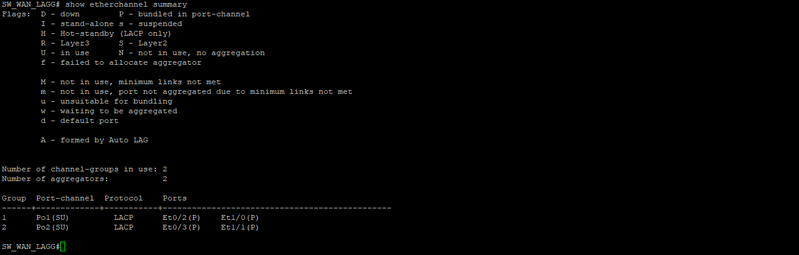
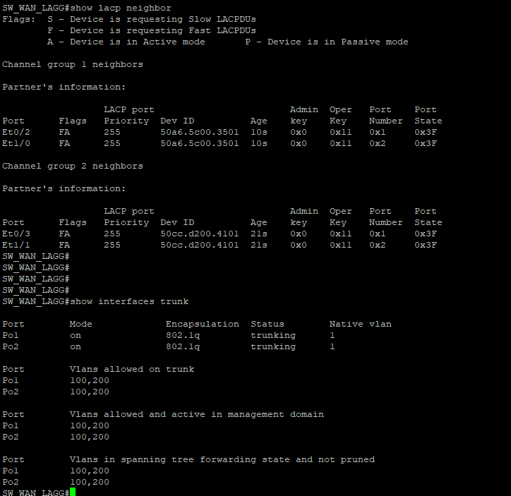
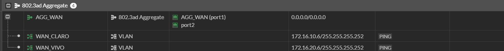
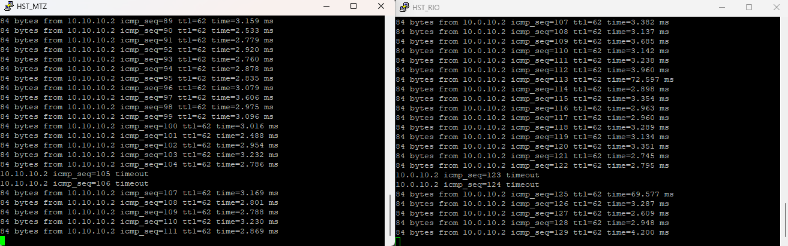
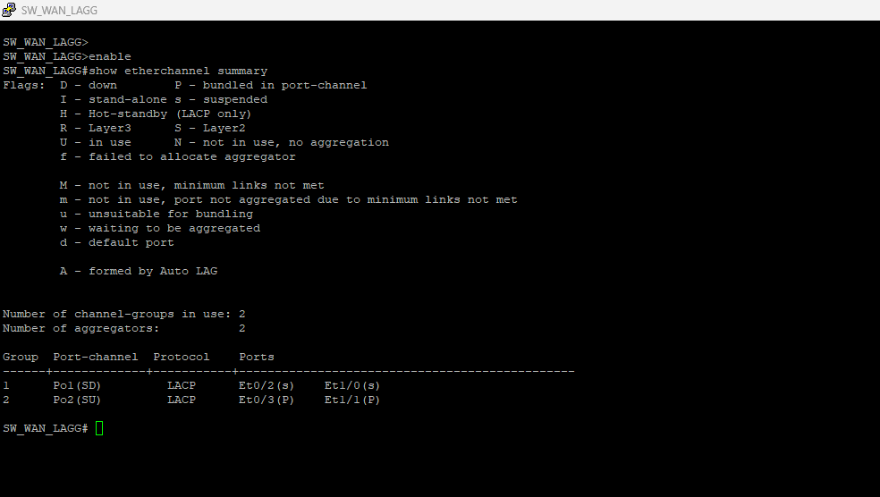
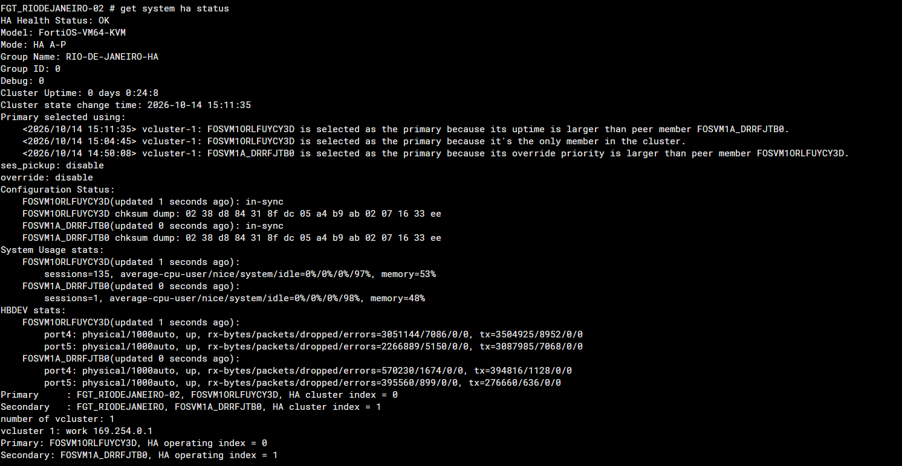
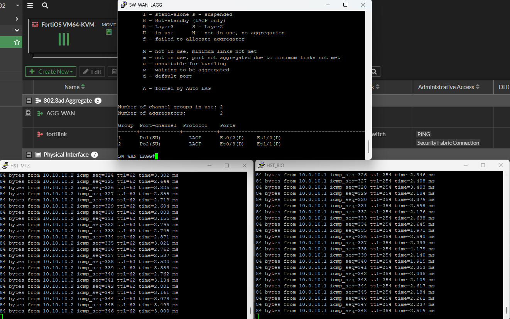
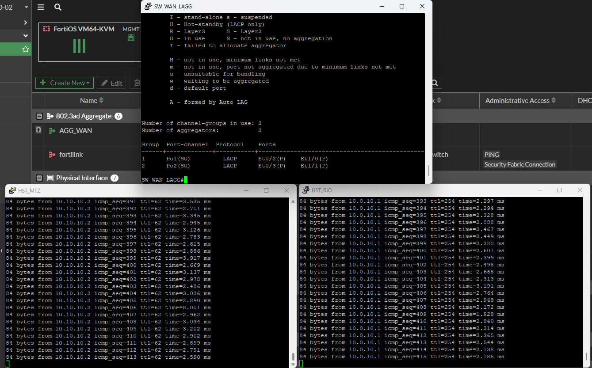

# LAG e failover no Rio de Janeiro

**Status: concluído —validações realizadas em 14/10/2026.**

Nesta etapa, validei o LACP na WAN do Rio, o failover do firewall ativo, a reintegração ao HA e a continuidade do tráfego com um membro do agregado desligado administrativamente.

## LAG operacional

Cada FortiGate usa `AGG_WAN` com `port1` e `port2`. No SW_WAN_LAGG, o Po1 atende o firewall 01 pelas portas Et0/2 e Et1/0; o Po2 atende o firewall 02 pelas portas Et0/3 e Et1/1. As VMs do Rio usam adaptadores e1000.

Os dois Port-channels estão `SU` (Layer 2, em uso), com os quatro membros em `P` (agregados).

Os vizinhos LACP identificam um FortiGate por grupo. As VLANs 100 e 200 estão permitidas, ativas e em forwarding nos dois trunks.

As interfaces `WAN_CLARO` (172.16.10.6/30) e `WAN_VIVO` (172.16.20.6/30) estão vinculadas ao agregado. Os endereços ficam nas VLANs, enquanto o AGG_WAN permanece sem IP.

## Failover do firewall ativo

Com pings contínuos entre os hosts da Matriz (10.0.10.2) e do Rio (10.10.10.2), desliguei o firewall 01, que era o Primary. O firewall 02 assumiu e a comunicação foi retomada automaticamente.

| Sentido | Timeouts consecutivos observados | Retomada |
|---|---|---|
| Matriz → Rio | Sequências 105 e 106 | Sequência 107 |
| Rio → Matriz | Sequências 123 e 124 | Sequência 125 |

Durante a operação pelo firewall 02, o Po2 permaneceu `SU`, com Et0/3 e Et1/1 em `P`. O Po1 corresponde ao firewall 01 desligado.

## Retorno e sincronização do cluster

Ao religar o firewall 01, ele retornou como Secondary. O firewall 02 permaneceu Primary. O HA apresentou status `OK`, ambos os membros `in-sync` e checksums iguais.

## Continuidade com um membro do LAG desligado

Com o firewall 02 ativo, apliquei `shutdown` na Et0/3 do SW_WAN_LAGG. O Po2 permaneceu `SU` pela Et1/1, enquanto a Et0/3 ficou `D`. Os pings continuaram respondendo: da Matriz para o host 10.10.10.2 e do Rio para a interface 10.0.10.1 da Matriz.

O trecho capturado mostra respostas consecutivas; não representa uma medição de perda total durante toda a transição.

Após o `no shutdown`, a Et0/3 voltou a `P`. Os dois Port-channels ficaram completos e os pings continuaram respondendo.

## Resultado final

Concluí o LAB com LACP operacional nos dois FortiGates do Rio, failover de firewall com retomada automática do tráfego, retorno ao HA sincronizado e continuidade validada no teste de desligamento administrativo de um membro do agregado.

[Configuração das interfaces e Port-channels](switches.md#sw_wan_lagg--lacp-e-vlans-wan-do-rio) · [Voltar ao início](../README.md)
